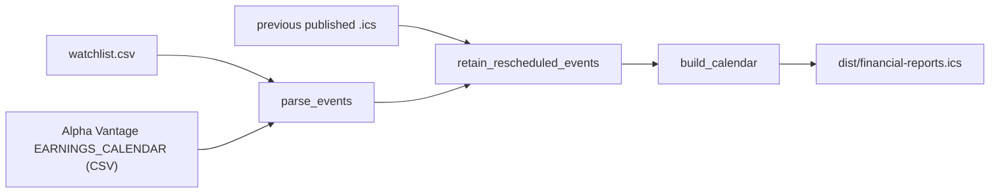
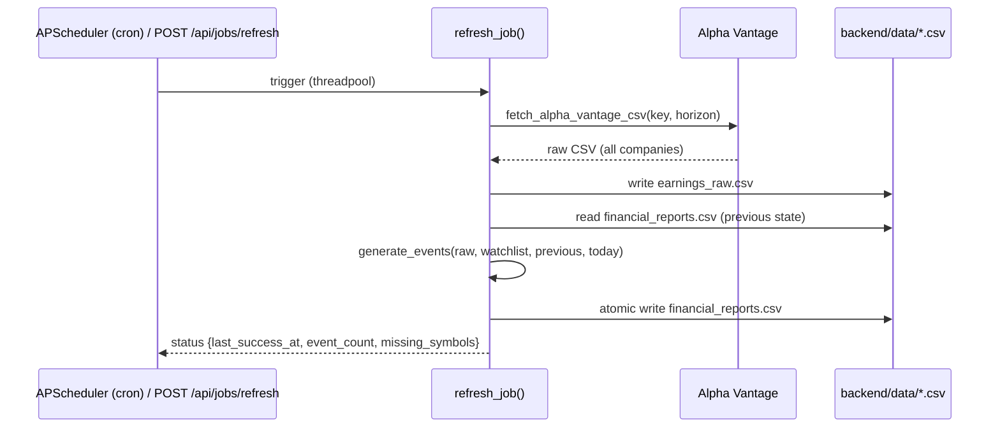

# Financial Reports App — Next.js + FastAPI

Turn the existing single-script `.ics` generator into a small local web app:

- **FastAPI backend** that serves earnings data from CSV files. It also runs a scheduled refresh job.
- **Next.js frontend** with a FullCalendar calendar page and a watchlist editor.
- The existing script remains a **standalone CLI utility**. The GitHub Actions → GitHub Pages `.ics` feed keeps working unchanged.

## Background: how the current code works

Today, [generate_financial_reports_calendar.py](file:///Users/awang/Documents/GitHub/automate-financial-report-to-calendar/scripts/generate_financial_reports_calendar.py) runs this pipeline:



> [!NOTE]
> The current logic does **not** keep the reports in a CSV. Alpha Vantage returns CSV, but the only output is `.ics`. Reschedule tracking reads its previous state back from the published `.ics`. This plan adds a real CSV data store, which the backend owns.

## User Review Required

> [!IMPORTANT]
> **Decisions from your answers:** FullCalendar, shadcn/ui (Tailwind v4), keep the GH Pages feed, local-only, plus "Refresh now" and the watchlist editor.

> [!WARNING]
> **Watchlist editing writes the tracked root `watchlist.csv`.** CI reads the same file, so UI edits show up as a git diff. Commit them if you want the GH Pages feed to follow.

> [!WARNING]
> **Alpha Vantage free tier ≈ 25 requests/day.** Each refresh costs 1 request (the whole market in one CSV). Limits:
> - The cron runs **once a day**.
> - "Refresh now" has a **5-minute cooldown**.
> - Watchlist edits **re-filter a cached raw CSV**, so they cost no API call.

> [!CAUTION]
> The in-process scheduler means you must run **one uvicorn worker**. With `--workers N` the job would run N times. `--reload` is fine in dev.

## Open Questions

1. **Cron schedule:** the default is daily at **06:00 America/Toronto**. It's configurable via the env var `REFRESH_CRON`. OK?
2. **Python env:** I'll create `backend/.venv` with Homebrew's **python3.12**. System Python is 3.9, which is too old for comfortable FastAPI/Pydantic use. OK?
3. **Package manager:** I'll use **pnpm** (installed) for the frontend. OK?

---

## Proposed Changes

### Target layout

```text
automate-financial-report-to-calendar/
├── scripts/generate_financial_reports_calendar.py   # core utility (lightly refactored, still a CLI)
├── tests/test_rescheduled_events.py                 # unchanged, must keep passing
├── watchlist.csv                                     # shared by CLI, CI and backend
├── backend/
│   ├── requirements.txt
│   ├── app/
│   │   ├── main.py          # FastAPI app, CORS, lifespan → scheduler
│   │   ├── config.py        # settings (paths, API key, cron, cooldown)
│   │   ├── core.py          # single import point for the core utility
│   │   ├── schemas.py       # Pydantic response/request models
│   │   ├── store.py         # CSV read/write (atomic, locked)
│   │   ├── jobs.py          # refresh job + in-memory status + scheduler
│   │   └── routers/{reports,watchlist,jobs}.py
│   ├── data/                # gitignored: financial_reports.csv, earnings_raw.csv
│   └── tests/test_api.py
├── frontend/                # Next.js 16 App Router + TS + Tailwind v4 + shadcn
└── Makefile                 # dev shortcuts
```

---

### 1. Core utility (`scripts/`)

#### [MODIFY] [generate_financial_reports_calendar.py](file:///Users/awang/Documents/GitHub/automate-financial-report-to-calendar/scripts/generate_financial_reports_calendar.py)

These are small additive changes. The CLI flags and the CI behavior stay identical.

- **`GeneratorError(RuntimeError)`** replaces `raise SystemExit(...)` inside library functions. Why: a `SystemExit` raised inside a FastAPI background thread would be treated as a shutdown signal, not as a job failure. `main()` catches `GeneratorError`, prints the message, and returns exit code 1, so CLI behavior is unchanged.
- **`fetch_alpha_vantage_csv`** becomes public for reuse. Its signature is unchanged.
- **New CSV store helpers** (pure functions, no FastAPI dependency):

```python
REPORT_CSV_FIELDS = [
    "symbol", "name", "report_date", "fiscal_date_ending",
    "estimate", "currency", "rescheduled_to",
]

def events_to_csv(events: Iterable[EarningsEvent]) -> str: ...
def events_from_csv(csv_text: str) -> list[EarningsEvent]: ...

def generate_events(
    source_csv: str,
    companies: dict[str, Company],
    previous_events: Iterable[EarningsEvent],
    today: date,
) -> list[EarningsEvent]:
    """parse_events + retain_rescheduled_events in one call (used by CLI and backend)."""
```

- **Optional CLI flags** `--output-csv PATH` and `--previous-csv PATH`. This lets the CLI also produce or consume the CSV store. CI doesn't use them.

---

### 2. Backend (`backend/`)

#### [NEW] `backend/requirements.txt`
```text
fastapi[standard]>=0.115
apscheduler>=3.10,<4
python-dotenv>=1.0,<2.0
pytest>=8
```

#### [NEW] `backend/app/config.py`
Settings come from env vars and the root `.env`, with sensible defaults:

| Setting | Default |
|---|---|
| `ALPHAVANTAGE_API_KEY` | from root `.env` (already present) |
| `WATCHLIST_PATH` | `<repo>/watchlist.csv` |
| `DATA_DIR` | `backend/data` |
| `REFRESH_CRON` | `0 6 * * *` |
| `REFRESH_TZ` | `America/Toronto` |
| `REFRESH_HORIZON` | `12month` |
| `REFRESH_COOLDOWN_SECONDS` | `300` |
| `CORS_ORIGINS` | `http://localhost:3000` |
| `SCHEDULER_ENABLED` | `true` (set `false` to disable the cron and startup refresh, e.g. in tests) |

#### [NEW] `backend/app/core.py`
This is the one place that puts `scripts/` on `sys.path` and re-exports the core functions. Everything else imports from `app.core`.

#### [NEW] `backend/app/store.py`
Two CSV files live in `DATA_DIR`:

- `earnings_raw.csv`: the last full Alpha Vantage response (cache for re-filtering).
- `financial_reports.csv`: the filtered watchlist events, including `rescheduled_to`. **This is what the API serves.**

Design:
- **Atomic writes:** write to a temp file, then `os.replace`. A reader never sees a half-written file.
- A module-level `threading.Lock` serializes writers (the cron job, Refresh, and watchlist edits).
- `updated_at` = mtime of `financial_reports.csv`. No extra metadata file.
- Watchlist read/write reuses the core's `read_watchlist`. Writes use the same `symbol,name` format.

#### [NEW] `backend/app/jobs.py`



- `BackgroundScheduler` (APScheduler, runs jobs in its own thread pool so the blocking fetch never touches the event loop) starts in FastAPI's `lifespan` (unless `SCHEDULER_ENABLED` is false) with `CronTrigger.from_crontab(REFRESH_CRON, timezone=REFRESH_TZ)`, plus `max_instances=1` and `coalesce=True`.
- **On startup:** if `financial_reports.csv` doesn't exist and an API key is configured, schedule one immediate refresh.
- In-memory `JobStatus`: `running, last_run_at, last_success_at, last_error, event_count, missing_symbols, next_run_at`.
- `refilter()`: rebuilds `financial_reports.csv` from the cached `earnings_raw.csv` after a watchlist change. It makes no network call.

#### [NEW] `backend/app/routers/*.py` — API surface

| Method | Path | Purpose |
|---|---|---|
| GET | `/api/health` | liveness |
| GET | `/api/reports?start=&end=&symbol=` | events from CSV, optional date-range/symbol filter |
| GET | `/api/calendar.ics` | same `.ics` as the CLI, built from the CSV (`text/calendar`) |
| GET | `/api/watchlist` | `[{symbol, name}]` |
| POST | `/api/watchlist` | add `{symbol, name}` → refilter |
| PUT | `/api/watchlist` | replace whole list → refilter |
| DELETE | `/api/watchlist/{symbol}` | remove → refilter |
| POST | `/api/jobs/refresh` | trigger update; `202`, `409` if running, `429` within cooldown |
| GET | `/api/jobs/status` | `JobStatus` |

Example response for `GET /api/reports`:
```json
{
  "updated_at": "2026-10-13T10:00:03Z",
  "reports": [
    {
      "id": "3fa1c2…@financial-reports.local",
      "symbol": "NVDA", "name": "NVIDIA",
      "report_date": "2026-10-28", "fiscal_date_ending": "2026-09-30",
      "estimate": "1.25", "currency": "USD",
      "rescheduled_to": null
    }
  ]
}
```
`id` reuses the core's `event_uid`, so it's stable across refreshes.

#### [NEW] `backend/tests/test_api.py`
These tests use `pytest` + `TestClient`. They monkeypatch `fetch_alpha_vantage_csv` with a fixture CSV and point `DATA_DIR`/`WATCHLIST_PATH` at temp dirs. They cover:
- reports filtering;
- refresh writes the CSV;
- a reschedule is retained across two refreshes (via the CSV, not the `.ics`);
- watchlist add/remove refilters without a fetch;
- `409`/`429` on refresh;
- `.ics` endpoint output.

---

### 3. Frontend (`frontend/`)

Scaffolded non-interactively:
```bash
pnpm dlx create-next-app@latest frontend --ts --app --tailwind --eslint --src-dir --import-alias "@/*" --use-pnpm
pnpm dlx shadcn@latest init
pnpm dlx shadcn@latest add button card dialog badge input table sonner tooltip toggle-group skeleton
pnpm add @fullcalendar/react temporal-polyfill   # FullCalendar v7 (+ its view plugins, verified at install)
```

> [!NOTE]
> FullCalendar is now on **v7** (headless core, `temporal-polyfill` peer). I'll pin v7. If v7's React integration has issues with React 19 / Next 16, I'll fall back to v6.1.x and tell you.

#### [NEW] `frontend/next.config.ts`
Adds a `rewrites()` rule: `/api/:path*` → `${BACKEND_URL ?? "http://localhost:8000"}/api/:path*`. The browser talks only to Next, so there's no CORS in normal use. FastAPI CORS stays as a fallback.

#### Pages & components

| File | Purpose |
|---|---|
| `src/app/layout.tsx` | dark theme, Inter/Geist font, top nav (Calendar · Watchlist), `<Toaster/>`, SEO metadata |
| `src/app/page.tsx` | redirect → `/calendar` |
| `src/app/calendar/page.tsx` | page shell + header (last updated, Refresh button) |
| `src/components/earnings-calendar.tsx` | `"use client"` FullCalendar: month / week / list views, all-day events |
| `src/components/event-dialog.tsx` | shadcn `Dialog`: company, fiscal period, EPS estimate, reschedule info |
| `src/components/refresh-button.tsx` | POST refresh → poll `/api/jobs/status` until done → toast + refetch; disabled while running or in cooldown |
| `src/components/symbol-filter.tsx` | `ToggleGroup` chips to show/hide symbols on the calendar |
| `src/app/watchlist/page.tsx` | shadcn `Table` of symbols, add form (symbol + name), delete with confirm |
| `src/lib/api.ts` | typed fetch helpers (data fetching/polling via **SWR**) + TS types mirroring `schemas.py` |
| `src/lib/colors.ts` | deterministic per-symbol color (hash → curated HSL palette) |

**Visual design:**
- Dark, premium theme, with FullCalendar's CSS variables mapped to shadcn tokens.
- Glassy card around the calendar.
- Per-symbol colored event pills.
- Rescheduled events appear as amber, dashed, struck-through pills with a "→ Oct 29" badge.
- Skeleton while loading; subtle hover and transition micro-animations.
- "Subscribe" button copies the `/api/calendar.ics` URL.

---

### 4. Repo plumbing

#### [MODIFY] [.gitignore](file:///Users/awang/Documents/GitHub/automate-financial-report-to-calendar/.gitignore)
Add `backend/data/`, `frontend/node_modules/`, `frontend/.next/`, `frontend/.env*.local`.

#### [NEW] `Makefile`
- `make setup`: creates the venv, pip installs, and runs `pnpm install`.
- `make backend`: `uvicorn app.main:app --reload --port 8000`.
- `make frontend`: `pnpm dev`.
- `make test`: runs the existing unittest, backend pytest, and the frontend lint/build.

#### [MODIFY] [README.md](file:///Users/awang/Documents/GitHub/automate-financial-report-to-calendar/README.md)
Adds an "App" section: architecture, setup, running, the API table, and the single-worker caveat.

#### Unchanged
- [update-calendar.yml](file:///Users/awang/Documents/GitHub/automate-financial-report-to-calendar/.github/workflows/update-calendar.yml): still runs the CLI weekly and publishes to Pages.
- Root `requirements.txt` stays CLI-only (`python-dotenv`).

---

## Verification Plan

### Automated Tests
```bash
# existing core tests — must still pass after the refactor
python3 -m unittest discover -s tests

# backend
backend/.venv/bin/pytest backend/tests -q

# CLI still produces identical .ics from a fixture (no network)
python3 scripts/generate_financial_reports_calendar.py --input-csv <fixture> --output /tmp/x.ics

# frontend type-check, lint, production build
cd frontend && pnpm lint && pnpm build
```

### Live / Browser Verification
1. Start the backend and frontend. Confirm the startup refresh creates `backend/data/financial_reports.csv` using your real API key (1 request).
2. `curl` `/api/reports`, `/api/jobs/status`, and `/api/calendar.ics`.
3. A browser subagent opens `http://localhost:3000/calendar` and:
   - switches month/week/list views;
   - opens an event dialog;
   - toggles symbol filters;
   - clicks Refresh (expects a toast, then cooldown);
   - adds and then removes a watchlist symbol, and checks that the calendar updates.

   I'll capture screenshots and a recording for the walkthrough.

### Manual Verification (you)
- Check the look and feel of the calendar and watchlist pages.
- Confirm that the `watchlist.csv` diff after UI edits is what you expect before committing.
